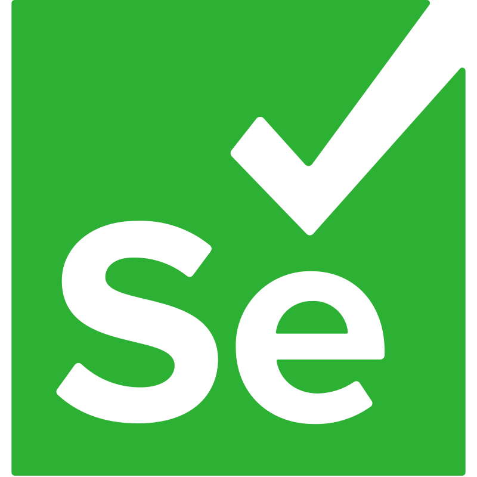
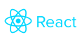
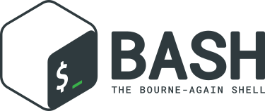
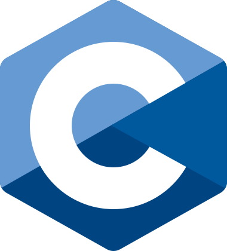
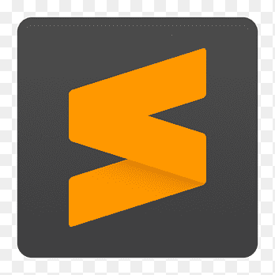

# EduardoB-Programador

## Português

Me chamo Eduardo Braga e, atualmente, estudo ciência da computação na faculdade. Tenho o objetivo de ser um desenvolvedor fullstack (mesmo que eu não seja realmente bom com tudo) Java e python, tenho uma paixão por programar e amo ficar pensando em soluções criativas para problemas além de pensar em projetos que, poderiam ou não, fazer sucesso e ajudar as pessoas.

Eu gosto muito de aprender coisas novas envolvendo tecnologia e outras coisas das minhas áreas de interesse. Tenho vontade de aprender mais linguagens de programação e mais tecnologias, aqui vai algumas coisas que eu **sei**, que **estou aprendendo** e **tenho a intenção de aprender**:

| Linguagens e/ou tecnologias que eu sei | Linguagens e/ou tecnologias que estou aprendendo | Linguagens e/ou tecnologias que quero aprender |
|:-:|:-:|:-:|
|    || |
|  ||   |
|     |||
|   |||
| |||

|WorkPlace|
|:-:|
|     |

## English

My name is Eduardo Braga, and I'm currently studying computer science on college. I want to be a fullstack developer (though I'm not great with everything) working with Java and python, I have a passion for programming and I love thinking about creative solutions for problems and think about projects, that may or may not, be a success and help people.

I really like learning new things about technology and other things. I want to learn more programming languages and more technologies, here are some things that I **know**, some that I'm currently **learning**, and some more that I **want to learn** in the future.

| Languages and/or technologies that I know| Languages and/or technologies that I'm currently learning | Languages and/or technologies that I want to learn |
|:-:|:-:|:-:|
|    || |
|  ||   |
|     |||
|   |||
| |||

|WorkPlace|
|:-:|
|    |
